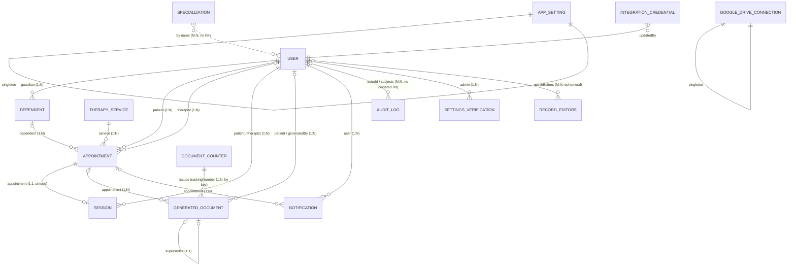

# Database Normalization & Schema Consolidation Audit

Date: 2026-11-22. Read-only audit: no model, service or test was changed.
Scope: the 16 models in `backend/src/models/`, plus how `backend/src/services/`, `backend/src/jobs/`, `backend/src/config/`, the controllers and the tests use them.

Decisions this audit follows (agreed before it was written):

- Copied fields that must stay frozen as they were at the time (issued PDFs, receipts, audit trail) are **kept** and flagged as deliberate 3NF exceptions.
- Collections are merged **only where the code shows real duplication**.
- Section 5 covers impact and risk only. It contains no migration scripts.

Constraints every proposal must respect: optimistic concurrency on `updatedAt` (`services/concurrencyService.js` `guardFresh` / `freshFilter`); API responses kept byte-identical (AGENTS.md); RBAC through `AppSetting.auth.permissions`; the audit capture hook (`services/auditCapture.js`); backup and restore (`services/backupService.js`); the 4 roles `user | therapist | admin | secretary`.

---

## 1. Current database inventory

| Model (collection) | File | Purpose | Key fields & embedded arrays | Outgoing refs | Incoming refs |
|---|---|---|---|---|---|
| **User** (`users`) | `userModel.js` | Accounts for all 4 roles, plus the therapist schedule and per-user Calendar OAuth | `email` (unique), `firstname`, `lastname`, `password`, `role`, `phone`, `notificationPreferences{}`, `specialization` (**Mixed**), `workingDays[]`, `workingHours{start,end}`, `workingHoursByDay[{day,start,end}]`, `dateOverrides[{date,unavailable,start,end}]`, `googleCalendar{connected,email,calendarId,refreshTokenEncrypted,…}`, `accountAudit[{action,by,at,details}]` | `accountAudit.by → User` | Almost every model (see ERD); `AuditLog.actorId` / `subjects` (ObjectIds with no declared ref) |
| **Dependent** (`dependents`) | `dependentModel.js` | A guardian's child or relative who has no login of their own | `guardian`, `firstName`, `lastName`, `dateOfBirth`, `sex`, `relationship`, `medicalNotes`, `isActive` | `guardian → User` | Appointment, Session, GeneratedDocument, Notification (`dependent`) |
| **TherapyService** (`therapyservices`) | `therapyServiceModel.js` | Service catalog | `name`, `description`, `duration`, `fee`, `category`, `isActive`, `auditLog[{action,by,at}]` | `auditLog.by → User` | Appointment.service, Session.service |
| **Specialization** (`specializations`) | `specializationModel.js` | Catalog of specialization names | `name`, `nameKey` (unique, lowercase) | — | **None.** `User.specialization` stores the names themselves, not ids (`specializationService.js` merges the catalog with `User.distinct("specialization")`) |
| **Appointment** (`appointments`) | `appointmentModel.js` | A booking, from request to completion, plus its payment | `patient`, `dependent`, `service`, `serviceSnapshot{name,duration,fee,category}`, `therapist`, `requestedDate/Time`, `scheduledStart/End`, `payment{status,amount,method,referenceNumber,recordedBy,recordedAt,notes}`, `paymentAudit[]`, `status`, `rescheduleRequest{}`, `cancelReason`, `cancelledBy`, `googleEventId`, `therapistGoogleEventId`, `googleEventLink`, `auditLog[]`, `reminderSentAt`, `remindersSentHours[]`, `notes`, `noShowMarkedBy/Role/At`. Indexes: `{patient,status,scheduledStart}`, `{status,scheduledStart}`, `{therapist,scheduledStart}` | `patient`, `therapist`, `cancelledBy`, `noShowMarkedBy`, `payment.recordedBy`, `auditLog.by`, `paymentAudit.by` → User; `dependent → Dependent`; `service → TherapyService` | Session, GeneratedDocument, Notification (`appointment`) |
| **Session** (`sessions`) | `sessionModel.js` | Clinical record of a completed visit | `appointment`, `patient`, `dependent`, `therapist`, `service`, `sessionDate`, `durationMinutes`, `patientVisibleNotes`, `clinicalNotes`, `editHistory[{editedBy,editedAt}]`, `editedAt`. **No indexes.** | `appointment → Appointment`; `patient`, `therapist`, `editHistory.editedBy` → User; `dependent`; `service` | — (RecordEditors key `sessions:<id>`) |
| **GeneratedDocument** (`generateddocuments`) | `generatedDocumentModel.js` | Issued PDFs (report, summary, visit record, receipt) with a verification tracking number | `trackingNumber` (unique), `type`, `title`, `subject`, `status`, `fileId`, `fileName`, `sha256`, `pdf` (Buffer, `select:false`), `patient`, `dependent`, `appointment`, `rangeFrom/To`, `generatedBy`, `generatedByRole`, `generatedByName`, `supersedes`, `supersededBy`, `revoked*`, `drive{status,fileId,…,lockToken,lockExpiresAt}`. 4 indexes | `patient`, `generatedBy`, `revokedBy` → User; `dependent`; `appointment`; `supersedes`/`supersededBy` → GeneratedDocument | Itself (supersede chain) |
| **DocumentCounter** (`documentcounters`) | `documentCounterModel.js` | Atomic sequence for each `PREFIX-YEAR` (`documentNumberService.allocateTrackingNumber`) | `key` (unique, e.g. `RCP-2026`), `seq` | — | — (its value ends up in `GeneratedDocument.trackingNumber`) |
| **Notification** (`notifications`) | `notificationModel.js` | In-app notifications | `user`, `type` (19-value enum), `title`, `message`, `appointment`, `dependent`, `link`, `isRead`, `readAt`. 2 indexes | `user → User`; `appointment`; `dependent` | — |
| **AuditLog** (`auditlogs`) | `auditLogModel.js` | Unified, append-only audit trail, captured automatically by `auditCapture.recordChange` | `_id` (String), `at`, `actorId`, `actorName`, `actorRole`, `category`, `action`, `resourceType`, `resourceId` (String, polymorphic), `result`, `changes[{field,before,after}]` (values redacted), `subjects[]`, `requestId`, `source` (`live/legacy/system`). 4 indexes, no TTL | Polymorphic `actorId`, `subjects` (no declared `ref`) | — |
| **SettingsAuditLog** (`settingsauditlogs`) | `settingsAuditLogModel.js` | Settings and credential change history, served raw by `GET` settings audit (`settingsController.getAudit`) | `admin`, `section`, `field`, `oldValue`, `newValue`, `ip`, `meta`, `createdAt` | `admin → User` | — (mirrored into AuditLog as `_id: settings:<id>`) |
| **AppSetting** (`appsettings`) | `appSettingModel.js` | The single clinic configuration document (`key: "singleton"`) | `general{}`, `auth{… , permissions{secretary,therapist,user}}`, `booking{}`, `schedule{openDays[],openHours,closedDates[]}`, `notifications{reminderLeadHours[]}`, `payments{enabledMethods[]}`, `integrations{*Enabled, *LastTest, restart*}`, `system{}`, `updatedBy`, `version`, `editLease*` | `updatedBy`, `integrations.restartRequestedBy` → User | — (RecordEditors key `settings:singleton`) |
| **IntegrationCredential** (`integrationcredentials`) | `integrationCredentialModel.js` | Encrypted key/value secrets for the 5 integration groups (`config/integrationKeys.js`), loaded by `config/runtimeConfig.js` | `key` (unique), `group` (indexed), `valueEncrypted`, `valueHash`, `previousEncrypted`, `fingerprint`, `verifiedAt`, `updatedBy`, `clearedAt` | `updatedBy → User` | — |
| **GoogleDriveConnection** (`googledriveconnections`) | `googleDriveConnectionModel.js` | The clinic's single Drive OAuth connection (`key: "clinic"`) | `connected`, `email`, `refreshTokenEncrypted`, `rootFolderId`, `connectedAt`, `connectedBy`, `needsReconnect`, `lastError` | `connectedBy → User` | — |
| **SettingsVerification** (`settingsverifications`) | `settingsVerificationModel.js` | One-time codes for sensitive admin actions (TTL `expiresAt`) | `admin`, `action`, `digest`, `codeHash`, `expiresAt`, `attempts`, `consumedAt` | `admin → User` | — (skipped by backup restore, `backupService.js:273`) |
| **RecordEditors** (`recordeditors`) | `recordEditorsModel.js` | Shows who is editing a record right now (TTL `expiresAt`) | `_id` = `"<kind>:<id>"`, `activeEditors[{userId,sessionId,name,lastSeenAt,joinedAt}]` | `activeEditors.userId → User`; polymorphic `_id` over users, dependents, appointments, sessions, services, settings | — |

---

## 2. Normalization audit and redundancy findings

MongoDB is not a relational database. Below, "violation" means the formal rule is broken; whether the break is a real problem is judged on what the code does.

### 1NF: atomic values, no repeating groups

| # | Location | Finding | Verdict |
|---|---|---|---|
| 1.1 | `User.specialization: Mixed` | Holds either a string or an array of strings. `availabilityService.specializationsOf` handles both shapes. A value that is sometimes atomic and sometimes multi-valued is a 1NF violation, and the schema does not validate it at all. | **Fix:** `[String]` |
| 1.2 | `User.accountAudit[]`, `Appointment.auditLog[]`, `Appointment.paymentAudit[]`, `Session.editHistory[]`, `TherapyService.auditLog[]` | Repeating groups that grow without limit inside the parent document. Every save rewrites the history, and every read loads it unless excluded (e.g. `secretaryService.js:67` `-accountAudit`). | Overlaps with AuditLog (see 3.1). Phase 2 |
| 1.3 | `User.workingDays[]` + `workingHours{}` + `workingHoursByDay[]` | The same schedule stored three ways (see 3NF 3.3). | **Fix** |
| 1.4 | `AppSetting.schedule.closedDates[]`, `notifications.reminderLeadHours[]`, `payments.enabledMethods[]`, `schedule.openDays[]`, `Appointment.remindersSentHours[]`, `User.dateOverrides[]` | Small arrays of atomic values with a fixed limit or a natural one (`dateOverrides` max 366 in `availabilitySchema.js:46`). Embedding them is idiomatic in MongoDB. | Keep |
| 1.5 | `AppSetting.integrations.*LastTest: Mixed` | Untyped blobs holding test results. | Keep. Display-only; tightening the type gains little |
| 1.6 | `RecordEditors.activeEditors[]` | Bounded by concurrent editors and expired by TTL. | Keep |

### 2NF: no partial dependency on part of a composite key

All collections use a single-field `_id`, so formal 2NF applies only where a composite key is packed into one field or into an array entry:

| # | Location | Finding | Verdict |
|---|---|---|---|
| 2.1 | `RecordEditors._id = "kind:id"`, entry key `(userId, sessionId)` | `activeEditors.name` depends only on `userId`, not on the full key `(userId, sessionId)`: a partial dependency. | Keep. Ephemeral (TTL), and saves a `User` lookup on every heartbeat |
| 2.2 | `DocumentCounter.key = "PREFIX-YEAR"` | Composite key encoded in a string; `seq` depends on the whole key. | Compliant |
| 2.3 | `AppSetting.auth.permissions.<role>.<area>.{crud}` | A role × area × action matrix with a fixed shape and no partial dependency. | Compliant |

### 3NF: no transitive or derived dependencies

| # | Location | Finding | Verdict |
|---|---|---|---|
| 3.1 | `Session.patient`, `.dependent`, `.therapist`, `.service` | Each is determined by `Session.appointment` (copied from the Appointment at `therapistService.createSessionForAppointment`). Transitive dependency. | **Keep, deliberate.** The appointment is `completed` and frozen once the session exists. These fields drive RBAC and list filters (`documentDataService.js:285`, `patientService.js:77/240`, `adminMonitoringService.js:163` aggregate) without a `$lookup` |
| 3.2 | `Appointment.serviceSnapshot{name,duration,fee,category}` | Duplicates `TherapyService` fields. | **Keep (historical copy).** Revenue aggregates sum `serviceSnapshot.fee` (`adminMonitoringService.js:253/282`); receipts and PDFs fall back to it |
| 3.3 | `User.workingDays`, `User.workingHours` | Both derived from `workingHoursByDay`: `saveAvailability` writes `workingDays = days.map(d=>d.day)` and `workingHours = summarize(days)` (`availabilityService.js:318-321`). Scheduling reads only `workingHoursByDay`, and falls back to the other two through `scheduleOf` for documents never migrated. The code comment says the derived bounds are "never read for scheduling". | **Fix:** after backfill (`scripts/backfillWorkingHours.ts` exists), stop storing them and derive them in the response, because the frontend reads `workingDays`/`workingHours` (`PeoplePage.tsx`, `format.ts`) |
| 3.4 | `Appointment.reminderSentAt` | Written only by `appointmentReminderJob.js:40` and reset in `adminAppointmentService.js:119`. Never read in the backend or the frontend; `remindersSentHours` is what deduplicates reminders. | **Remove** |
| 3.5 | `AppSetting.auth.googleAuthEnabled`, `auth.recaptchaEnabled` | The same toggles exist under `integrations.*`. Every runtime read uses `integrations.*` (`settingsService.js:193/204`); the `auth.*` copies are only accepted by the Zod schema (`settingsSchema.js:51,53`). No frontend reference found. | **Remove** (model and Zod schema) |
| 3.6 | `AppSetting.auth.secretaryCanOpenDocuments`, `secretaryCanViewDriveStatus`, `therapistCanOpenDocuments` | These overlap with `auth.permissions.<role>.documents`, but they gate a different action (opening and Drive status, not the CRUD actions). Read at `settingsService.js:154-172`. | Keep |
| 3.7 | `Session.editedAt` | Equals the last `editHistory[].editedAt`. | Keep; cheap and may be displayed |
| 3.8 | `Appointment.noShowMarkedRole` | Derivable from `noShowMarkedBy` → `User.role`, but roles change over time. | Keep (historical copy) |
| 3.9 | `GeneratedDocument.generatedByName`, `generatedByRole`, `subject`, `title` | Copies of facts as they were when the document was issued. | **Keep.** Document verification must show the issuer as they were at issue |
| 3.10 | `GeneratedDocument.supersededBy` | The reverse of `supersedes`, so derivable by query. | Keep; verification looks it up in O(1) |
| 3.11 | `GeneratedDocument.patient`, `.dependent` when `appointment` is set | Transitive through the appointment, but `patient_summary` and `clinic_report` have no appointment, and the `{patient, createdAt}` index serves lists. | Keep |
| 3.12 | `Notification.dependent` | Transitive through `appointment` when set. Notifications are immutable messages. | Keep |
| 3.13 | `AuditLog.actorName`, `actorRole` | Historical copies of the actor. | **Keep (audit integrity)** |
| 3.14 | `RecordEditors.activeEditors.name` | See 2.1. | Keep |
| 3.15 | `GeneratedDocument.fileId` vs `drive.fileId` | **Not redundant.** The top-level `fileId` is a local UUID (`documentService.js:297`); `drive.fileId` is the Google Drive id. | Compliant |

### Overlapping and single-document collections

| Pair or group | What the code shows | Verdict |
|---|---|---|
| **AuditLog vs SettingsAuditLog** | Every `SettingsAuditLog` insert is already mirrored into `AuditLog` by `auditCapture.recordChange` (`_id: settings:<id>`, category settings/integration/backup). The data is written twice. **But** `GET` settings audit returns raw `oldValue`/`newValue`/`ip`/`meta` (`settingsController.getAudit`, `latestAudit*`), while `AuditLog.changes` redacts every field outside the `safeValue` allow-list. | **Merge** (the only true overlap). The conditions are in 3.2 |
| AppSetting / IntegrationCredential / GoogleDriveConnection / SettingsVerification | Four different shapes and lifecycles: a public config singleton (sent to clients through `publicSettings`), an encrypted key/value secret store, a single OAuth token holder, and expiring one-time codes. Putting the Drive refresh token into AppSetting would put a secret into a document sent to clients. Putting it into IntegrationCredential breaks its `key/group/value` shape. Putting codes into AppSetting loses the TTL. | **Keep separate** |
| RecordEditors / DocumentCounter | RecordEditors depends on a TTL index. DocumentCounter depends on an atomic `$inc` upsert per key. Neither fits inside another document without a hot-spot singleton or losing the TTL. | **Keep as-is** |
| User vs Dependent | Dependents cannot log in, have no email or password, and belong to a guardian. Merging them would make most User fields nullable and complicate auth. Role-specific User fields (schedule, Calendar) are a small, sparse set. | **Keep separate** |
| Appointment vs Session | Effectively 1:1 (a session can only be created on a `confirmed`, past appointment, which then becomes `completed`), but with distinct data (clinical notes) and distinct RBAC (`sessions` area, therapist-only edits, `clinicalNotes` hidden from patients). **However, there is no unique index on `Session.appointment`**: two concurrent creates without `If-Match` can both pass the status check. | **Keep separate**; add a unique index |
| Specialization vs User.specialization | The catalog is linked only by name. | Keep both; type the User field (1.1) |

---

## 3. Consolidation and redesign decisions

### 3.1 Collections to remove (1)

| Collection | Where its data and behavior go |
|---|---|
| **SettingsAuditLog** | Into **AuditLog** (see 3.2). Its history is already copied there by `importLegacyAudit` (`legacy:settings:*`) and by live capture (`settings:*`). |

### 3.2 Collections to merge (1 → into an existing one)

**SettingsAuditLog → AuditLog.** Required so no behavior is lost:

1. `writeSettingsAudit`, `integrationCredentialService.writeAudit` and the `insertMany` in `updateSettingsSection` write `AuditLog` rows directly (`category`, `action: "<section>.<field>"`, `resourceType: "AppSetting"`, `resourceId: "singleton"`).
2. Add two optional fields to AuditLog: `ip: String` and `meta: Mixed`. Settings rows also need **unredacted** `before`/`after` for non-secret settings, because `GET` settings audit shows them today. Option (a): a settings value policy in `auditCapture` that redacts only secret-shaped fields, keeping `hidden` for credentials. Option (b): accept `[redacted]` in the settings history UI. **This choice is yours to make.**
3. `latestAudit`, `latestAuditForKeys` and `getAuditEntries` query AuditLog (`category ∈ {settings, integration, backup}`, `action` / `changes.field`) and map rows back to the current `{admin{firstname,lastname}, section, field, oldValue, newValue, ip, meta, createdAt}` shape, so the response stays byte-identical. The cursor uses `at`.
4. Remove the `SettingsAuditLog` branch in `auditCapture.recordChange` and its entry in `AUDIT_CATEGORIES`.
5. Backups: `backupService.js:171` writes a `settingsauditlogs` row on restore, and restore **rejects backups containing unknown collections** (`backupService.js:254`). Backups taken before the change would fail to restore unless `settingsauditlogs` is accepted and folded into AuditLog (or dropped) on restore.

No other merge is justified by the code.

### 3.3 Collections to keep separate and redesign (5)

| Collection | Changes |
|---|---|
| **User** | `specialization: Mixed` → `[String]` (trimmed; validated against Specialization `nameKey` on write). Stop storing `workingDays` and `workingHours` after backfilling `workingHoursByDay`, and derive both in the controller responses (frontend reads them). Phase 2: `accountAudit[]` → AuditLog |
| **Appointment** | Drop `reminderSentAt`. Phase 2: `auditLog[]` and `paymentAudit[]` → AuditLog. Keep `serviceSnapshot`, `payment`, `noShowMarkedRole` (historical copies / transaction facts) |
| **Session** | Add indexes: `{appointment:1}` **unique**, `{therapist:1, sessionDate:-1}`, `{patient:1, sessionDate:-1}`. Keep the copied `patient/dependent/therapist/service` (deliberate, frozen at completion). Phase 2: `editHistory[]` → AuditLog |
| **TherapyService** | Phase 2: `auditLog[]` → AuditLog |
| **AppSetting** | Drop `auth.googleAuthEnabled` and `auth.recaptchaEnabled` from the model and from `settingsSchema.js` (`integrations.*` stays authoritative) |

**Phase 2 (embedded histories → AuditLog)** is real duplication, but it is not free. Readers still use the embedded arrays: `authController.js:62` (`accountAudit`), `secretaryController.js:28` (payment history), `documentDataService.js:505` (`auditLog` rows printed into PDFs), and `adminUserService.js:46-70` (`populate("accountAudit.by")`). AuditLog also redacts `details` and array values (e.g. the schedule change text in `availabilityService.js:326`). Do it only after the redaction policy from 3.2 is settled.

### 3.4 Collections to keep as-is (10)

Dependent, Specialization, GeneratedDocument, DocumentCounter, Notification, AuditLog (gains the optional `ip`/`meta` fields only), IntegrationCredential, GoogleDriveConnection, SettingsVerification, RecordEditors.

Tally: 1 removed + 5 redesigned + 10 kept = 16.

---

## 4. Proposed normalized schema

**Collection count: 16 → 15.** Going lower would mean putting secrets into the public settings document or losing TTL and atomic-counter semantics; the code does not justify it.

### Field definitions after the changes (only changed or key fields are listed in full)

```text
users                 _id PK; email UNIQUE; role enum(user|therapist|admin|secretary)
                      specialization [String]                      ← was Mixed
                      workingHoursByDay [{day,start,end}]          ← sole schedule source
                      (workingDays, workingHours removed; derived in responses)
                      dateOverrides [{date,unavailable,start,end}]
                      googleCalendar {connected,email,calendarId,refreshTokenEncrypted,…}
                      accountAudit[]                               (phase 2: remove)
dependents            _id PK; guardian FK→users (required)
therapyservices       _id PK; name, duration, fee, category, isActive; auditLog[] (phase 2)
specializations       _id PK; nameKey UNIQUE
appointments          _id PK; patient FK→users; dependent FK→dependents?; service FK→therapyservices;
                      therapist FK→users?; serviceSnapshot{} (historical); payment{} ; status
                      (reminderSentAt removed); remindersSentHours [Number]
                      IDX {patient,status,scheduledStart} {status,scheduledStart} {therapist,scheduledStart}
sessions              _id PK; appointment FK→appointments UNIQUE   ← new unique
                      patient, therapist FK→users; dependent?; service (frozen copies)
                      IDX {therapist,sessionDate:-1} {patient,sessionDate:-1}   ← new
generateddocuments    _id PK; trackingNumber UNIQUE; patient?, dependent?, appointment?,
                      generatedBy FK→users; supersedes/supersededBy FK→generateddocuments (self)
                      IDX unchanged (4)
documentcounters      _id PK; key UNIQUE ("PREFIX-YEAR")
notifications         _id PK; user FK→users; appointment?; dependent?   IDX unchanged (2)
auditlogs             _id String PK; actorId?; subjects [ObjectId]; resourceType+resourceId (polymorphic)
                      + ip String, + meta Mixed                    ← absorbs settingsauditlogs
                      IDX unchanged (4); no TTL
appsettings           _id PK; key UNIQUE "singleton"; (auth.googleAuthEnabled, auth.recaptchaEnabled removed)
integrationcredentials _id PK; key UNIQUE; group IDX
googledriveconnections _id PK; key UNIQUE "clinic"
settingsverifications _id PK; admin FK→users; TTL expiresAt
recordeditors         _id String "kind:id" (polymorphic); TTL expiresAt
```

### ERD



---

## 5. Impact and migration risk

| Change | Code to touch | Tests affected | Risk / trade-off |
|---|---|---|---|
| SettingsAuditLog → AuditLog | `services/settingsService.js` (`latestAudit`, `latestAuditForKeys`, `getAuditEntries`, `writeSettingsAudit`, `updateSettingsSection`), `services/integrationCredentialService.js:256`, `controllers/settingsController.js:707` (caller only), `services/auditCapture.js` (branch + category), `services/auditService.js` (legacy import of `settingsauditlogs`), `services/backupService.js:5,171,254`, `models/auditLogModel.js` (+`ip`,`meta`), delete `models/settingsAuditLogModel.js` | `tests/integration-defaults.test.mjs` (imports SettingsAuditLog); `tests/audit.test.mjs` (settings rows, `_id: settings:*`) | **High.** The response must stay byte-identical (`createdAt` cursor, `admin` populated). The redaction policy is your decision. Restoring an old backup fails without a compatibility path |
| Drop `User.workingDays` / `workingHours` | `services/availabilityService.js` (`scheduleOf` fallback, `saveAvailability`), `controllers/adminUserController.js:29-41,192,321-323,373`, `controllers/therapistController.js:30,62,84`, `schemas/availabilitySchema.js` (input `workingDays` stays as request shape), `services/adminAppointmentService.js:6` (select), `services/adminUserService.js` | Any test asserting those fields (check `tests/qa-fixes`, `tests/bug-regressions`) | **Medium.** Run the backfill first, or `scheduleOf` loses its legacy fallback. Responses must keep deriving both fields for `PeoplePage.tsx` / `format.ts` |
| `User.specialization` → `[String]` | `services/availabilityService.js:98`, `services/adminUserService.js:40` (regex search works on arrays), `services/specializationService.js` (drop `typeof === "string"` filter), user create/update schemas | Seed (`scripts/seed.ts`) | Low. Existing string values must be wrapped in an array |
| Drop `Appointment.reminderSentAt` | `jobs/appointmentReminderJob.js:40`, `services/adminAppointmentService.js:119` | None found | Low |
| Drop `AppSetting.auth.googleAuthEnabled` / `recaptchaEnabled` | `models/appSettingModel.js`, `schemas/settingsSchema.js:51,53` (strict schema: a client still sending them gets a 400) | `tests/integration-defaults`, `tests/rbac` if they post a full `auth` section | Low/medium. Check the frontend settings form payload first |
| Session indexes (+unique `appointment`) | `models/sessionModel.js` only | `tests/bug-regressions`, `tests/documents` (create sessions) | Low. Index creation **fails if duplicate sessions already exist**; check with an aggregate first |
| Phase 2: embedded histories → AuditLog | `authController.js:62`, `secretaryController.js:28-36`, `documentDataService.js:505`, `adminUserService.js:46-142`, `availabilityService.js:323`, `adminAppointmentService.js:27`, `adminMonitoringService.js:62-103`, `secretaryService.js:16,67-83,136-149`, `serviceCatalogService.js:16-31`, `therapistService.js:201,306`, `adminBootstrapService.js:52,73`, `auditCapture.js` (ignored regex), `auditService.importLegacyAudit` | `tests/audit`, `tests/personal-activity`, `tests/qa-fixes` | **High.** Each read becomes an extra AuditLog query. Redaction loses the `details` text currently printed into PDFs and the payment history. Not recommended until the 3.2 policy exists |

**Join cost vs historical accuracy.** Nothing in this proposal adds a `.populate()` or `$lookup` to a hot path. Every copied field kept (`serviceSnapshot`, `Session.*` copies, `GeneratedDocument.generatedBy*`, `AuditLog.actor*`) is kept precisely so receipts, verification and audit history show the facts as they were.

**Concurrency.** None of the changes alter `updatedAt` semantics on the records guarded by `If-Match`. Removing a field from Appointment or User does not change how `guardFresh` works.
